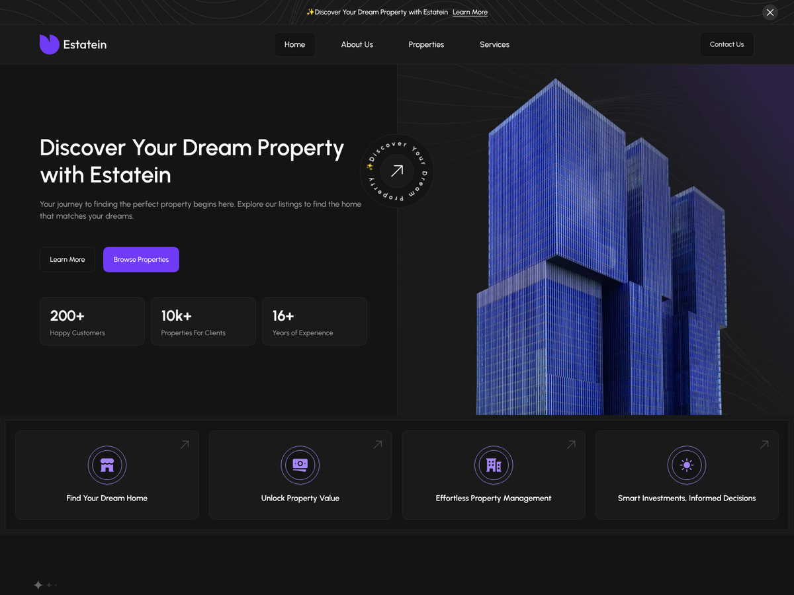

# Estatein — Custom WordPress Theme

A custom WordPress theme built from the **Estatein (Dark) real-estate Figma template**. It delivers the Home page pixel-close to the design at desktop (1920), laptop (1440) and mobile (390), with every piece of content editable from the WordPress admin.

**Live demo:** _add your InfinityFree/Wasmer URL here_



## Features

- **Custom theme, no page builder:** hand-written PHP templates, one CSS file, one small vanilla JS file (no jQuery).
- **Custom post types:** Properties (with a *Property Type* taxonomy), Testimonials and FAQs.
- **ACF-powered content:** every Home section (hero, stats, feature cards, section headings, CTA) plus property and client details. Field groups are registered in PHP (`inc/acf-fields.php`), so they are version-controlled and work with **free ACF**.
- **Graceful fallbacks:** if ACF is inactive or a field is empty, the theme falls back to the design copy, so the site never renders blank.
- **Customizer settings:** announcement banner, Contact URL, copyright and social links.
- **Menus:** Primary, Footer (top-level items become column headings) and Legal.
- **Interactive pieces:**
  - Scroll-snap sliders with arrows, keyboard support and a live "01 of 04" counter.
  - Expandable FAQ answers.
  - Dismissible banner.
  - Accessible mobile menu.
- **Newsletter sign-up:** nonce plus honeypot protected. Subscribers are stored as a private post type.
- **One-click demo import:** a dashboard notice button (or `wp estatein import-demo`) builds the Home page, 6 properties, 6 testimonials, 6 FAQs, the menu and media.
- **SEO:**
  - Meta description and Open Graph / Twitter tags.
  - JSON-LD for `RealEstateAgent`, `RealEstateListing` and `FAQPage`.
  - Automatically disabled when Yoast SEO or Rank Math is active.
- **Performance:**
  - Self-hosted Urbanist WOFF2 fonts, preloaded.
  - Responsive hero image preloaded with `fetchpriority="high"`.
  - WebP images with lazy loading, deferred JS, and block-library CSS dropped.
- **Accessibility:**
  - Skip link, landmarks and visible focus styles.
  - ARIA on the sliders, menu and FAQs.
  - `prefers-reduced-motion` support.

## Quality checks (local, WordPress 7.1.4 / PHP 8.3)

| Check | Result |
| --- | --- |
| Lighthouse mobile: Performance / Accessibility / Best Practices / SEO | 96 / 100 / 100 / 100 |
| Lighthouse desktop: Performance | 100 |
| axe-core (WCAG 2 A/AA + best practices), 1440px and 390px | 0 violations |
| Horizontal overflow at 1920 / 1440 / 390 | none |
| PHP notices with `WP_DEBUG` on | none |

## Installation

1. Upload the `estatein` folder to `wp-content/themes/`, or upload `estatein.zip` via **Appearance → Themes → Add New → Upload**.
2. Install and activate **Advanced Custom Fields** (the free version is enough).
3. Activate **Estatein**.
4. On the Dashboard, click **Import demo content**. The Home page is set as the front page automatically.
5. Go to **Settings → Permalinks** and click **Save** once so property URLs work.

## Structure

```
estatein/
├── style.css, functions.php, screenshot.png
├── header.php, footer.php, front-page.php, index.php
├── archive-property.php, single-property.php
├── inc/
│   ├── setup.php               theme supports, menus, image sizes, cleanup
│   ├── enqueue.php             assets, font + hero preloading
│   ├── post-types.php          property / testimonial / faq + taxonomy
│   ├── acf-fields.php          ACF field groups in code
│   ├── template-functions.php  helpers, design defaults, Customizer
│   ├── newsletter.php          sign-up handler
│   ├── seo.php                 meta + JSON-LD
│   └── demo-content.php        one-click / WP-CLI importer
├── template-parts/
│   ├── home/                   hero, features, properties, testimonials, faqs, cta
│   └── components/             section-header, card-property, slider-controls
└── assets/ css, js, fonts, icons (SVG), images (WebP)
```

## Requirements

WordPress 6.5+ (tested up to 7.1), PHP 8.0+, Advanced Custom Fields (recommended).

## Credits

Design: Estatein Real Estate Website UI Template — Dark Theme (Produce UI, Figma Community). Font: Urbanist (SIL Open Font License).
